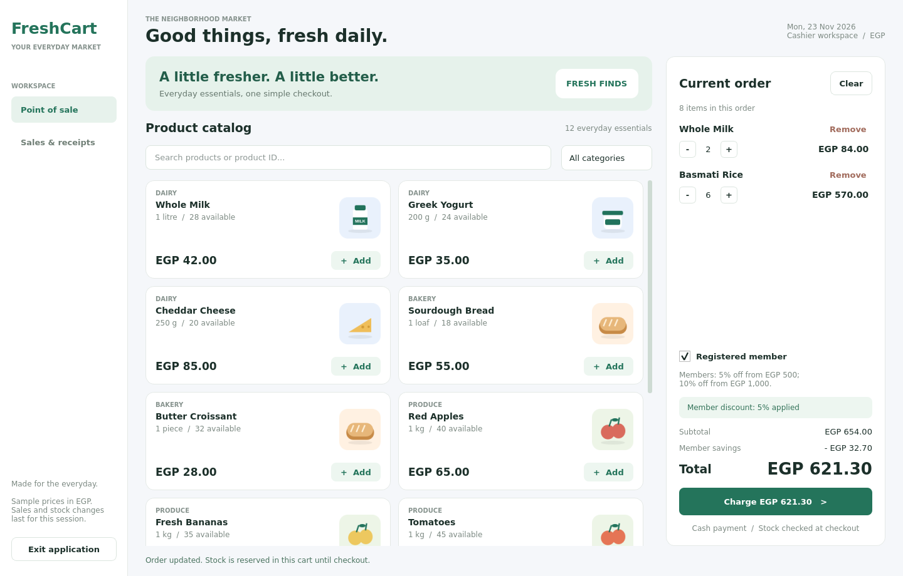

# FreshCart - Mini Supermarket Billing System

A real C++ desktop application built with **Qt Widgets**, plus a **C++ console application** for the course's mandatory console requirement. Both use the same billing and inventory functions.



## Features

- Product catalog with 12 sample products, search by name/ID and category filters.
- Cart with add, increase, decrease, remove and clear actions.
- Live totals and member discount eligibility.
- Cash checkout, insufficient-payment rejection and automatic change calculation.
- Inventory deducted only after a successful payment.
- Session sales summary, receipt history and export to `.txt`.
- A six-option console menu using `cin`, `cout`, `switch`, `do-while`, `for` and input validation.

All sample prices are in **EGP**; these are demonstration prices, not live market prices.
Data is **in memory for the current session**. Closing resets sales and stock. Export receipts before exiting. No database or network service is used.

## Discount rules

| Customer | Subtotal | Discount |
|---|---:|---:|
| Standard | Any | 0% |
| Registered member | Below EGP 500 | 0% |
| Registered member | EGP 500 to below EGP 1,000 | 5% |
| Registered member | EGP 1,000 or more | 10% |

The 10% rate replaces the 5% rate. No taxes or extra fees are added. Currency uses integer piastres; discounts round half up to the nearest piastre.

## Windows / Visual Studio (primary course setup)

1. Install **Visual Studio 2022** with **Desktop development with C++**, a Windows SDK and C++ CMake tools.
2. Install **Qt 6** with the **MSVC 2022 64-bit** desktop kit. Use the MSVC kit, not the MinGW kit, for this Visual Studio setup.
3. Run `build_windows.bat` and enter your Qt kit directory when prompted, e.g. `C:\Qt\6.8.3\msvc2022_64` (replace with your installed path).
4. The script builds both applications, runs the core checks and deploys the Qt runtime DLLs.
5. Run `run_windows.bat`, or open `build-win\Release\FreshCart.exe`.
6. For the console application, open `build-win\Release\FreshCartConsole.exe`.

Full commands and troubleshooting: [Windows guide](docs/RUN_WINDOWS.md).
Arabic explanation: [دليل التشغيل والمناقشة](docs/GUIDE_AR.md).

**Only need the console?** Run `build_console_only.bat` from an x64 Native Tools Command Prompt for Visual Studio. Qt is not needed for that build.

## CMake commands

```sh
# Point CMAKE_PREFIX_PATH at your installed Qt desktop kit.
cmake -S . -B build -DCMAKE_PREFIX_PATH="YOUR_QT_KIT_PATH"
cmake --build build --config Release
ctest --test-dir build -C Release --output-on-failure
```

On Windows the GUI is `build/Release/FreshCart.exe`. With a single-config Linux generator it is `build/FreshCart`.

To build only the console and core checks without Qt:

```sh
cmake -S . -B build-console -DFRESHCART_BUILD_GUI=OFF
cmake --build build-console --config Release
```

Or compile the console directly with a C++17 compiler:

```sh
g++ -std=c++17 -Wall -Wextra -pedantic src/console.cpp src/store.cpp -o FreshCartConsole
./FreshCartConsole
```

Linux desktop dependencies (Debian/Ubuntu): `g++`, `cmake`, `qt6-base-dev`. Build using the same CMake commands; a normal desktop session is needed to display the window.

## Tests

```sh
cmake -S . -B build -DFRESHCART_GUI_TESTS=ON -DCMAKE_PREFIX_PATH="YOUR_QT_KIT_PATH"
cmake --build build --config Release
ctest --test-dir build -C Release --output-on-failure
```

The optional GUI test drives actual Qt widgets and writes screenshots into `build/screenshots`. It uses Qt's `offscreen` platform; this platform plugin must be available to run it without a display. It does not modify your real files or launch an external service.

See [test evidence](docs/TEST_RESULTS.md) for the tested environment and results. Windows/Visual Studio has a supplied build path but was not executed in the Linux development environment.

## Source files

| File | Purpose |
|---|---|
| `src/store.h`, `src/store.cpp` | Products, cart, discounts, stock, checkout, receipt text |
| `src/mainwindow.h`, `src/mainwindow.cpp` | Desktop layout and button actions |
| `src/main.cpp` | Starts the Qt desktop application |
| `src/console.cpp` | Course console menu and robust input parsing |
| `tests/core_tests.cpp` | Billing, boundaries, stock and failed-checkout checks |
| `tests/gui_smoke.cpp` | Desktop workflow integration checks |

## Course submission

The PDF report is a **draft** until the team's 3-5 full names, student IDs and actual contributions are filled in. The rubric map is in [REQUIREMENTS.md](docs/REQUIREMENTS.md).

Before submitting:

- Fill in the team details in `docs/TEAM.csv` and update the PDF report.
- Build and demonstrate **both applications in Visual Studio** on your machine.
- Upload this source tree to a **public GitHub repository** and submit its real URL.
- Publish the prepared LinkedIn draft with screenshots or a demo and your GitHub URL; submit the actual post URL.
- All team members must understand and explain their own work. Use the Arabic guide to prepare.

No repository or social post has been published by this package. Do not invent links or claim work your team did not perform.

## Official setup references

- Qt Widgets: https://doc.qt.io/qt-6/widgets-getting-started.html
- Qt with CMake: https://doc.qt.io/qt-6/cmake-get-started.html
- Qt package paths: https://doc.qt.io/qt-6/cmake-making-qt-available.html
- Qt on Windows / Visual Studio: https://doc.qt.io/qt-6/windows.html
- Windows deployment: https://doc.qt.io/qt-6/windows-deployment.html

Qt is an external dependency; its libraries are not included in the source ZIP. Its applicable licenses remain those of Qt. Product illustrations in the GUI are drawn directly in C++ using QPainter.

To update the PDF after entering team details (use English full names in TEAM.csv):

```sh
python -m pip install reportlab
python tools/generate_report.py
```

Python/ReportLab is needed only to regenerate the report, not to build or run either C++ application.
